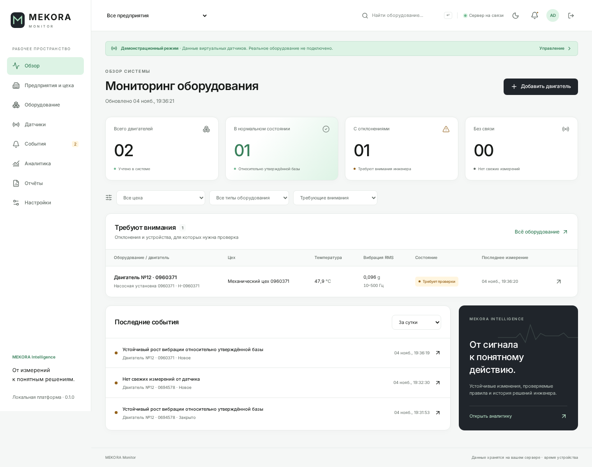

# MEKORA Monitor · 0.1.0

Рабочий прототип промышленного мониторинга. **Виртуальный датчик → HTTP API → база
данных → живые графики → проверяемое предупреждение → действия инженера.**

Интерфейс на русском, светлая и тёмная темы, адаптация под ноутбук. Никакой
телеметрии не рисуется непосредственно в браузере: все точки проходят через API
и сохраняются. Демонстрационный источник отмечается в интерфейсе и выгрузке.



## Запуск на Windows: вариант 1 — Docker Desktop

Этот вариант использует PostgreSQL. Python и Node.js на компьютере не нужны.

1. Установите [Docker Desktop для Windows](https://docs.docker.com/desktop/setup/install/windows-install/).
   При предложении включить WSL 2 согласитесь, перезагрузите компьютер и запустите
   Docker Desktop. Дождитесь состояния «Engine running».
2. Скачайте репозиторий: **Code → Download ZIP**, распакуйте, например в
   `C:\Projects\MEKORA_SITE`. Либо `git clone https://github.com/SoVeSt125/MEKORA_SITE.git`.
3. Откройте папку проекта в Проводнике. В адресной строке введите `powershell`
   и нажмите Enter. Вы должны находиться рядом с `docker-compose.yml`.
4. Создайте локальную конфигурацию:

   ```powershell
   powershell -NoProfile -ExecutionPolicy Bypass -File .\scripts\Init-Env.ps1
   ```

   Команда создаёт `.env` со случайными секретами. Существующий файл не заменяется.
   Откройте его командой `notepad .env`: логин **admin**, пароль — значение справа
   от `MEKORA_ADMIN_PASSWORD=`. Не публикуйте этот файл.
5. Запустите:

   ```powershell
   docker compose up --build -d
   docker compose ps
   ```

   Первая сборка скачивает зависимости; нужен Интернет. Дождитесь `healthy` у
   backend и database, состояния `Up` у frontend и simulator.
6. Откройте **http://localhost:8080**. Войдите с созданными данными.

Остановка: `docker compose down`. Повторный запуск: `docker compose up -d`.
Обновление исходников: `git pull`, затем `docker compose up --build -d`.
Пароль существующего пользователя при перезапуске не меняется.
**Не добавляйте `-v` к `down`: этот флаг удаляет тома с данными.**

## Запуск на Windows: вариант 2 — без Docker

Использует SQLite и тот же API/интерфейс. База PostgreSQL отдельно не требуется.

1. Установите [Python 3.12](https://www.python.org/downloads/) с Python Launcher
   (`py`) и [Node.js 24 LTS](https://nodejs.org/). Заново откройте терминал.
2. Распакуйте исходники в обычную папку, например `C:\Projects\MEKORA_SITE`.
3. Дважды нажмите **`start-windows.cmd`**. При первом запуске он создаст `.venv`,
   установит зафиксированные зависимости, создаст `.env`, применит миграции и
   создаст администратора. Интернет нужен для установки зависимостей.
4. Оставьте окно открытым. Откройте **http://localhost:5173**.
5. Логин **admin**, пароль — значение `MEKORA_ADMIN_PASSWORD` в `.env`.

`Ctrl+C` в окне запуска останавливает сервер, интерфейс и симулятор. База остаётся
в `data\mekora.db`, очередь датчика — в `data\simulator-outbox.db`.
Повторный запуск той же команды сохраняет пользователей, двигатели и историю.
Локальные профили Docker и SQLite имеют отдельные базы: переключение между ними
не переносит данные автоматически.

Альтернатива ручному запуску после установки Python и Node.js:

```powershell
py -3.12 -m venv .venv
.\.venv\Scripts\python.exe -m pip install -r backend\requirements.lock
cd frontend
npm ci
cd ..
.\.venv\Scripts\python.exe scripts\init_env.py
.\.venv\Scripts\python.exe scripts\run_local.py
```

## Первый двигатель и живые измерения

1. Откройте **«Предприятия и цеха» → «Предприятие»**, задайте своё название.
2. Кнопкой **«Цех»** добавьте цех этого предприятия.
3. Кнопкой **«Агрегат»** создайте станок/установку, укажите инвентарный номер.
4. **«Оборудование» → «Добавить двигатель»**. Выберите агрегат, заполните мощность,
   номинальные обороты и другие известные данные. Ограничение температуры
   необязательно; задавайте его по технической документации своего двигателя.
5. Откройте двигатель → **«Добавить датчик»**. Задайте уникальный серийный номер,
   например `SIM-001`. Это виртуальная регистрация, без BLE-поиска.
6. В блоке симулятора выберите исправный режим и нажмите **«Запустить»**.
7. Через несколько секунд появятся температура, RMS и линии графиков.
   Интервал по умолчанию 2 с. SSE обновляет интерфейс приблизительно каждые 2 с.
   Все обновления поступают от отдельного Python-процесса/контейнера.

## Проверка отклонения и работа инженера

1. Соберите минимум **10 корректных измерений** в стабильном режиме. Убедитесь,
   что исходное состояние можно использовать как исправное.
2. В карточке двигателя нажмите **«Утвердить базовый уровень» → «Подтвердить»**.
   Автоматического утверждения нет. Учитываются последние 30 корректных измерений
   за 10 минут с одинаковой полосой и сопоставимой нагрузкой/оборотами.
3. Нажмите **«Создать отклонение»**. Симулятор постепенно увеличит вибрацию.
4. После трёх последовательных свежих превышений `2×` базы появится событие.
   Один импульс не создаёт предупреждение. Устойчивая аномалия не создаёт
   одинаковое событие на каждом пакете.
5. Откройте **«События» → событие**. Посмотрите измеренный факт, основания,
   ограничения и рекомендуемые проверки MEKORA Intelligence.
6. Переведите событие **«Принято в работу» → «На проверке»**, записывая комментарии.
7. Запишите результат осмотра, флаг подтверждения и выполненные работы.
8. Переведите в **«Подтверждено» → «Устранено» → «Закрыто»** с результатом.
   Для неподтверждённой причины — **«Не подтвердилось» → «Закрыто»**.
9. Нажмите **«Восстановить норму»** в симуляторе. После трёх значений не выше
   `1,5×` базы условие помечается восстановленным. Ручное закрытие без восстановления
   не порождает повтор той же непрерывной аномалии.

Другие сценарии: повышение температуры, другая нагрузка/обороты, единичный импульс,
низкая батарея и потеря связи. После 30 с без свежих данных статус станет **«Нет
связи»**, даже если последнее сохранённое значение было нормальным. Если изменился
рабочий режим, относительная диагностика приостанавливается до сопоставимых условий.
Температурное событие требует трёх превышений заданного инженером ограничения;
восстановление — на 5 °C ниже него. Универсального порога вибрации в мм/с нет.

## Реализовано в 0.1.0

- React + TypeScript, Vite, Tailwind, Radix/shadcn-style UI, Lucide, Recharts,
  TanStack Query, Router. Переключение темы сохраняется локально.
- FastAPI, SQLAlchemy, Alembic; PostgreSQL и локальная SQLite.
- Вход, серверные сессии, Argon2id, CSRF и проверка ролей на API. Администратор
  создаёт главного инженера, инженера или наблюдателя в настройках.
- Создание предприятия/цеха/агрегата, создание и изменение двигателя,
  архивирование/возврат без удаления истории, регистрация виртуального датчика.
- Виртуальные измерения X/Y/Z, температура, батарея, RSSI, режим, полоса и качество;
  версия протокола, идемпотентность, учёт пропусков и задержанных пакетов.
- Живые графики температуры, общего и поканального RMS, выбор периода, подсказки,
  масштабирование нижним ползунком, линии базы и температурного ограничения.
- Явное утверждение базы, детерминированная аналитика, подтверждение условий,
  гистерезис, подавление повторов, предупреждения, осмотры, работы и история статусов.
- Отчёт по двигателю, CSV для Excel, печать отчёта браузером в PDF, резервное
  копирование SQLite. Все разделы меню содержат работающие функции.

Это первый работающий срез, **не завершение всех будущих разделов большого ТЗ**.
Настоящий BLE, перенос датчиков между установками, управление конфигурацией прошивки,
полный редактор структуры предприятия, график FFT по переданной диагностической
записи, загрузка вложений, многопредприятие с изоляцией прав и промышленная
сертификация остаются отдельными этапами. Виброскорость из одного RMS не выводится.
Алгоритмы RMS/FFT/частотного интегрирования проверены на синтетических сигналах,
но запись waveform пока не передаётся. Модель машинного обучения и оценка времени
до отказа не заявляются. Команд управления двигателями нет.

## Структура и документация

`frontend/` — Monitor; `backend/app/` — API, база, ingestion, правила и безопасность;
`backend/alembic/` — миграции; `simulator/` — отдельный отправитель;
`gateway/` — интерфейс будущего адаптера; `scripts/` — запуск и копирование БД.

- [Архитектура](docs/architecture.md)
- [API и роли](docs/api.md)
- [Протокол данных](docs/data-protocol.md)
- [Диагностические правила](docs/diagnostic-rules.md)
- [Предварительные требования к устройству](docs/hardware-requirements.md)
- [Дальнейший план](docs/development-plan.md)
- [Результаты проверок и скриншоты](docs/verification.md)

## Разработка и проверки

Python 3.12, Node.js 24. Для Linux/macOS замените `.venv\Scripts\python.exe`
на `.venv/bin/python`. После установки зависимостей:

```powershell
.\.venv\Scripts\python.exe -m pytest backend\tests simulator\tests -q
cd frontend
npm run build
npx playwright install chromium
# Во втором окне предварительно запустите scripts/run_local.py.
# Браузерный тест добавляет записи в выбранную локальную БД: используйте тестовую.
npm run test:e2e
```

Браузерный тест читает локальный пароль из `.env` или `MEKORA_TEST_PASSWORD`,
по умолчанию работает с `http://localhost:5173`. Для Docker задайте
`$env:MEKORA_TEST_URL="http://localhost:8080"`. Проходит настоящий путь через
отдельный симулятор; API-запросы не подменяются. Скриншоты — `docs/screenshots`.
Не публикуйте трассы неудачных тестов с реальными учётными данными.

## Резервные копии

SQLite, из корня проекта:

```powershell
.\.venv\Scripts\python.exe scripts\backup_sqlite.py --target backups\mekora-backup.db
```

Для восстановления остановите локальное приложение и верните копию как
`data\mekora.db`; сохраните исходную БД отдельно, также учитывайте её WAL/SHM файлы.
Не заменяйте открытый файл работающего приложения. Ключи и `.env` храните отдельно.

PostgreSQL: `pg_dump` внутри контейнера, затем копирование файла без искажения
бинарного вывода PowerShell:

```powershell
docker compose exec -T database pg_dump -U mekora -d mekora -Fc -f /tmp/mekora.dump
docker compose cp database:/tmp/mekora.dump .\mekora-backup.dump
```

Восстанавливайте `pg_restore` в отдельную пустую БД и проверяйте копию до подмены
основной. Том `postgres_data` переживает обычный `docker compose down`.

## Если не запускается

- **Docker не отвечает:** запустите Docker Desktop, проверьте WSL 2.
- **Порт занят:** остановите другое приложение на 8080 (Docker) либо 5173/8000
  (локально). Локальный запуск не должен незаметно перейти на другой порт.
- **Нет графиков:** проверьте **«Запустить»** у датчика и работу процесса simulator.
  Для Docker: `docker compose logs --tail 50 simulator backend`.
- **Вход не работает:** используйте пароль из той `.env`, с которой впервые создали
  эту БД. Изменение `.env` не сбрасывает существующие пароли. Не удаляйте БД ради входа.
- **«Недостаточно данных»:** это нормальное исходное состояние до сбора и утверждения базы.
- **Нет предупреждения:** нужны сопоставимый режим, свежие корректные измерения,
  утверждённая база для относительного правила и три превышения подряд.
- **После смены порта вход не работает:** добавьте адрес браузера в
  `MEKORA_ALLOWED_ORIGINS` в `.env`, перезапустите backend.

Профиль запуска рассчитан на локальный компьютер и слушает только loopback.
Для удалённого промышленного развёртывания нужны HTTPS, secure-cookie, секреты
окружения, резервное копирование, сетевые ограничения и отдельная проверка защиты.
Статического хостинга Cloudflare Pages недостаточно для FastAPI и постоянной БД.
