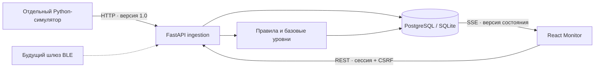

# Архитектура MEKORA · первый рабочий срез

Репозиторий при обследовании пустой (без коммитов и прикладных файлов).
Существующий Pet_Project не затрагивается: в нём есть локальные изменения.

Модульный монолит: API, SQLAlchemy-модели, ingestion и независимая аналитика.
Alembic управляет схемой. PostgreSQL — основной профиль Docker, SQLite — локальный
профиль без Docker. Один backend worker; SSE сверяет сохранённую версию состояния,
а не держит единственную копию данных в памяти. После переподключения UI повторно
читает API; измерения не зависят от открытого браузера.

React + TypeScript + Vite, Tailwind, доступные Radix/shadcn-style примитивы,
Lucide, React Router, TanStack Query, Recharts. Отдельные типы транспорта.
Токены светлой и тёмной темы в CSS; графики строятся только по API.

Иерархия: предприятие → цех → агрегат → двигатель → установка → датчик.
В первом срезе одна неизменяемая установка на датчик и двигатель: перенос датчика
не предлагается, чтобы не смешивать историю. Архивирование сохраняет измерения.
Измерения имеют уникальные ID и пару device/sequence, время UTC, источник,
полосу, качество и ссылку на установку. Повторы идемпотентны, конфликт ID — 409.

Сессии: Argon2id, случайные HttpOnly cookie, CSRF для записей, роли на API.
Учётные данные первого администратора создаются локально, публичного signup нет.
Симулятор аутентифицируется отдельным ключом и видит только виртуальные устройства.
Для шлюза зарезервирован отдельный ключ устройства; настоящий BLE не реализован.

Порядок: фундамент и миграция → оборудование → симулятор/API/график → базовый
уровень с явным утверждением → устойчивые отклонения/гистерезис → события,
осмотры, устранение и экспорт → интеграционные проверки и документация Windows.
Будущие аппаратные и расширенные функции перечисляются отдельно от реализованных.
